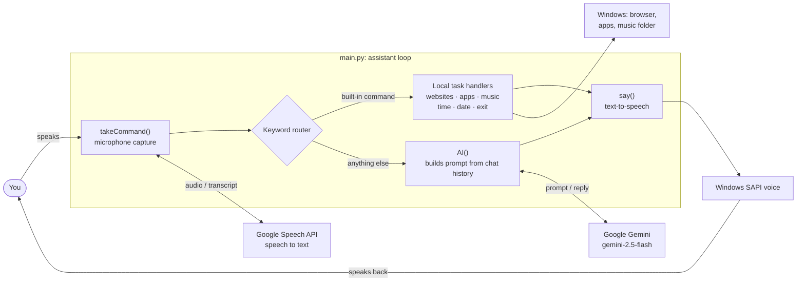
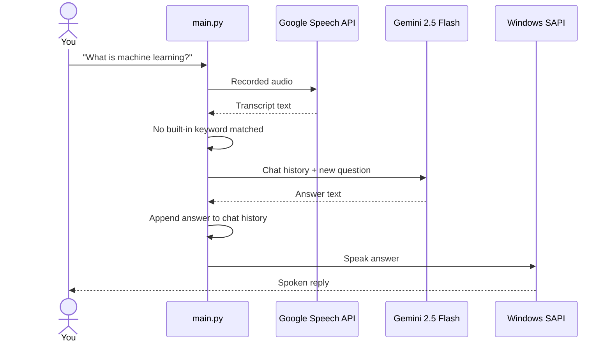
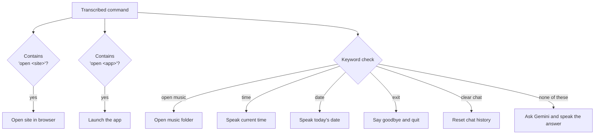

<div align="center">

<h1>AI-Powered Voice Assistant</h1>

<p><i>A Python desktop assistant that listens, automates everyday tasks and answers anything else with Google Gemini</i></p>


**Speak a command and the assistant opens websites and apps, plays your music or tells the time and date.<br>Ask it anything else and Gemini answers out loud, remembering the conversation so far.**

[Features](#features) · [How It Works](#how-it-works) · [Voice Commands](#voice-commands) · [Getting Started](#getting-started) · [Roadmap](#roadmap)

</div>

---

## Overview

**AI-Powered Voice Assistant** is a hands-free desktop assistant written in Python. It runs a continuous listen → understand → act loop:

1. **Listen.** The microphone captures your voice and Google's speech recognition converts it to text (tuned for Indian English, `en-in`).
2. **Understand.** A keyword router checks whether the request is a built-in task, such as opening a website, launching an app, playing music or telling the time.
3. **Act.** Built-in tasks run instantly on your machine. Anything else goes to **Google Gemini 2.5 Flash**, and the reply is spoken aloud through the Windows text-to-speech engine.

Every exchange with Gemini is added to a running chat history that is sent with the next question, so follow-ups like *"tell me more about that"* work naturally.

## Features

| Feature | How it works |
|---|---|
| **Voice input** | `speech_recognition` records from the microphone, waits for a 1-second pause to detect the end of a sentence, then transcribes with the Google Speech API. |
| **Spoken replies** | Responses are read aloud by the built-in Windows SAPI voice via `win32com.client`, with no extra TTS service required. |
| **AI conversation** | Open-ended questions are answered by **Gemini 2.5 Flash** through the official `google-genai` SDK. |
| **Conversation memory** | Each question and answer is appended to a chat history that is sent with every new prompt, giving Gemini multi-turn context. Say *"clear chat"* to start fresh. |
| **Open websites** | Ten popular sites (YouTube, Google, GitHub, LinkedIn, Wikipedia and more) open in your default browser on command. |
| **Launch apps** | Opens desktop apps such as Notepad and Calculator through `os.startfile`. |
| **Play music** | Opens your local music folder. |
| **Time and date** | Speaks the current time or today's date, for example *"Today's date is 11 October 2026"*. |
| **Graceful errors** | Unclear speech and network failures are caught and reported instead of crashing the recognizer. |

## How It Works

### Architecture



### One request, end to end



### How commands are routed



## Voice Commands

| Say | What happens |
|---|---|
| *"Open YouTube"* | Opens the site in your browser. Also works for Google, Facebook, Wikipedia, Twitter, Instagram, LinkedIn, GitHub, Reddit and Amazon. |
| *"Open Notepad"* / *"Open Calculator"* | Launches the app. |
| *"Open music"* | Opens your music folder. |
| *"What's the time?"* | Speaks the current time. |
| *"What's the date today?"* | Speaks today's date. |
| *"Clear chat"* | Forgets the conversation so far. |
| *"Exit"* | Says goodbye and closes the assistant. |
| *Anything else* | Sent to Gemini, and the answer is spoken aloud. |

## Tech Stack

| Layer | Technology |
|---|---|
| Language | Python 3.x |
| Speech to text | `SpeechRecognition` with the Google Web Speech API |
| Microphone access | `PyAudio` |
| Text to speech | Windows SAPI (`SAPI.SpVoice`) via `pywin32` |
| AI model | Google Gemini 2.5 Flash via `google-genai` |
| Task automation | `webbrowser`, `os.startfile`, `time` |

## Project Structure

```
AI-Powered-Voice-Assistant/
├── AIVoiceAssistant/
│   ├── main.py            # Assistant loop: listen, route, act, speak
│   ├── googlegemini.py    # Standalone script to test your Gemini API key
│   └── config.py          # Holds API_KEY (keep this out of version control)
└── README.md
```

## Getting Started

### Prerequisites

- **Windows 10 or 11.** Text-to-speech uses the built-in Windows SAPI voice.
- **Python 3.9+**
- A working **microphone** and an **internet connection** (speech recognition and Gemini both run in the cloud).
- A free **Gemini API key** from [Google AI Studio](https://aistudio.google.com/apikey).

### 1. Clone the repository

```bash
git clone https://github.com/Ashwin-Laad/AI-Powered-Voice-Assistant.git
cd AI-Powered-Voice-Assistant/AIVoiceAssistant
```

### 2. Install dependencies

```bash
pip install SpeechRecognition pyaudio pywin32 google-genai
```

> If `pyaudio` fails to install, upgrade pip first (`python -m pip install --upgrade pip`) and try again. Recent versions ship prebuilt Windows wheels.

### 3. Add your API key

Open `config.py` and paste your key:

```python
API_KEY = "your-gemini-api-key"
```

Check that the key works:

```bash
python googlegemini.py
```

You should see a short explanation of how AI works printed in the terminal.

### 4. Set your music folder (optional)

In `main.py`, point `music_path` at your own music folder:

```python
music_path = "C:/Users/<your-username>/Music"
```

### 5. Run the assistant

```bash
python main.py
```

The assistant says *"Hello, I am a voice assistant"* and starts listening. Speak after **"Listening..."** appears in the terminal.

## Configuration

| What to change | Where |
|---|---|
| Gemini model | `model="gemini-2.5-flash"` in `AI()` in `main.py` |
| Recognition language | `language='en-in'` in `takeCommand()`; use `en-US`, `hi-IN` and so on |
| End-of-speech pause | `r.pause_threshold = 1` (seconds of silence before it stops listening) |
| Websites and apps | The `sites` and `apps` lists in the main loop. Add `["name", "url-or-exe"]` pairs. |
| Assistant personality | The `instruction` string in `AI()` |

## Troubleshooting

| Problem | Fix |
|---|---|
| `"Sorry, I did not understand that."` | Speak clearly after "Listening...", reduce background noise, or check your default microphone in Windows sound settings. |
| `"Could not request results"` | Speech recognition needs internet access. Check your connection. |
| `ModuleNotFoundError: win32com` | Run `pip install pywin32`. |
| Gemini errors or no reply | Make sure `API_KEY` in `config.py` is set, then run `python googlegemini.py` to test it. |
| Music command fails | Update `music_path` in `main.py` to a folder that exists on your PC. |

## Contributing

Contributions, issues and suggestions are welcome.

1. Fork the repo
2. Create a branch: `git checkout -b feature/your-feature`
3. Commit your changes: `git commit -m "Add your feature"`
4. Push and open a Pull Request

## Author

**Ashwin Laad**: [@Ashwin-Laad](https://github.com/Ashwin-Laad)


---

<sub>Built to explore speech recognition, text-to-speech and large language model integration in Python.</sub>
